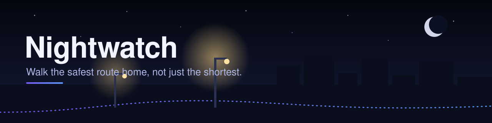
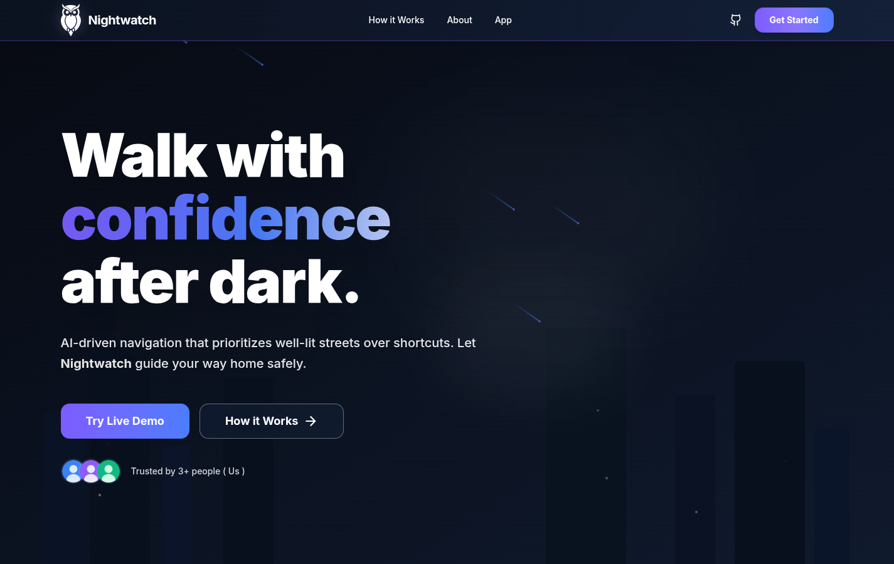
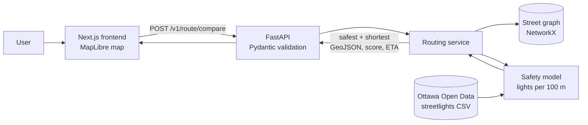

<p align="center">
  
</p>

<p align="center">
  <a href="https://nightwatch-seven.vercel.app"></a>
  
</p>

<p align="center">
  
  
  
  
  
  
  
  
</p>

<p align="center">
  <a href=".github/assets/nightwatch-demo.mp4"></a>
  <br>
  <sub>Silent preview. Click it for the full video with sound (MP4).</sub>
</p>

# Nightwatch

Nightwatch is a walking-route app for after dark. Instead of only returning the fastest path, it compares the **shortest** route against the **safest** one, scoring paths by streetlight density using the City of Ottawa's Open Data.

Built at **CUMSA Hacks (January 2026)**, where it placed **Top 5**.

## Demo

**Live: [nightwatch-seven.vercel.app](https://nightwatch-seven.vercel.app)**




## Features

- **Safest vs shortest** - one request returns both routes as GeoJSON, with distance, ETA, a safety score, a coverage label and human-readable reasons.
- **Streetlight-based scoring** - each road segment is scored by lights per 100 m, and the safest path minimizes a safety-adjusted cost instead of raw distance.
- **Strict API contracts** - Pydantic schemas with nested models validate every request and response.
- **Contract tests** - pytest integration tests use FastAPI's `TestClient` to validate the routing endpoints and response schema.
- **Interactive map UI** - Next.js app with MapLibre map, route comparison, insights and saved-routes screens.
- **Demo mode** - `DEMO_MODE=1` serves mock data for fast, offline-safe demos.

## Architecture



The shortest path uses Dijkstra on edge length. The safest path uses Dijkstra on a safety-adjusted edge cost derived from streetlight density.

## API overview

Base path: `/v1` (full contract in [`shared/api-contract.json`](shared/api-contract.json)). Interactive docs at `/docs` when running locally.

| Method | Endpoint | Description |
|--------|----------|-------------|
| `GET` | `/v1/health` | Health check, returns `{"status": "ok"}` |
| `POST` | `/v1/route/compare` | Compare the safest and shortest routes between two points |

Request body (`RouteRequest`):

```json
{
  "start": { "lat": 45.4215, "lng": -75.6972 },
  "end": { "lat": 45.4275, "lng": -75.6880 },
  "mode": "night",
  "maxDetour": 15,
  "weights": { "lights": 80, "cameras": 45 },
  "useCctv": false
}
```

Response (`RouteResult`): `safest` and `shortest`, each a `RouteData` with `geojson`, `distance_m`, `eta_min`, `safety_score`, `coverage` and `reasons`.

## Tech stack

| Layer | Technology |
|-------|------------|
| Frontend | Next.js 16, React 19, TypeScript, Tailwind CSS 4, MapLibre GL, TanStack Query, Zustand, Framer Motion, GSAP |
| Backend | Python, FastAPI, Uvicorn, Pydantic v2 |
| Routing and data | NetworkX, pandas, NumPy, SciPy, Ottawa Open Data streetlights |
| Testing | pytest, FastAPI TestClient, httpx |
| Deployment | Vercel (frontend), Render (backend) |

## Project structure

```
Nightwatch/
├── frontend/                 Next.js app (src/app pages, src/lib API client)
├── backend/
│   ├── app/
│   │   ├── main.py           FastAPI app, CORS, router mounting
│   │   ├── settings.py       Env-driven config (DEMO_MODE, CORS_ORIGINS, PORT)
│   │   ├── api/              Routes and Pydantic schemas
│   │   ├── services/         Router adapter, routing engine, safety model, light store
│   │   └── data/             Ottawa streetlight CSV and graph builder
│   ├── scripts/              Run scripts and data utilities
│   └── tests/                pytest contract tests
├── shared/                   API contract and sample payloads
└── design/                   Design mockups
```

## Getting started

Prerequisites: Python 3.10+ and Node.js 20+.

### Backend

```bash
cd backend
python3 -m venv .venv
source .venv/bin/activate        # Windows PowerShell: .venv\Scripts\Activate.ps1
pip install -r requirements.txt
DEMO_MODE=0 uvicorn app.main:app --reload --host 127.0.0.1 --port 8000
```

Or use the helper script, which creates the venv, installs dependencies and starts the server: `./backend/scripts/run_backend.sh` (macOS/Linux/WSL) or `.\backend\scripts\run_backend.ps1` (Windows).

`DEMO_MODE=1` serves mock routes; `DEMO_MODE=0` runs the real graph and streetlight scoring. Optional settings are listed in [`backend/env.example`](backend/env.example); `CORS_ORIGINS` is a comma-separated list.

Check it: <http://127.0.0.1:8000/v1/health> and <http://127.0.0.1:8000/docs>.

### Frontend

```bash
cd frontend
cp env.local.example .env.local
npm install
npm run dev
```

Open <http://localhost:3000>. The env file sets `NEXT_PUBLIC_API_URL` (default `http://127.0.0.1:8000/`), `NEXT_PUBLIC_API_PREFIX` (`/v1`) and `NEXT_PUBLIC_USE_MOCK`.

## Running tests

```bash
cd backend
pytest tests/
```

The tests call `/v1/health` and `/v1/route/compare` through FastAPI's `TestClient` and check the response keys and types against the contract.

## Deployment

| Service | Setting | Value |
|---------|---------|-------|
| Render (backend) | Root directory | `backend` |
| | Build command | `pip install -r requirements.txt` |
| | Start command | `uvicorn app.main:app --host 0.0.0.0 --port $PORT` |
| | Env | `DEMO_MODE=0`, `CORS_ORIGINS=<frontend URL>` |
| Vercel (frontend) | Root directory | `frontend` |
| | Env | `NEXT_PUBLIC_API_URL=<backend URL>`, `NEXT_PUBLIC_API_PREFIX=/v1`, `NEXT_PUBLIC_USE_MOCK=false` |

## Design


## Team

Built by the Nightwatch team at CUMSA Hacks:

- [Saim Hashmi](https://github.com/anakafeel)
- Arsh Jameel
- Jadov29
- senuradissa

## Author

**Saim Hashmi** - 4th-year Computer Systems Engineering student at Carleton University.
GitHub: [@anakafeel](https://github.com/anakafeel)
